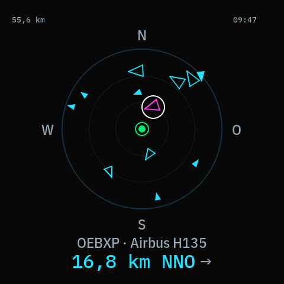
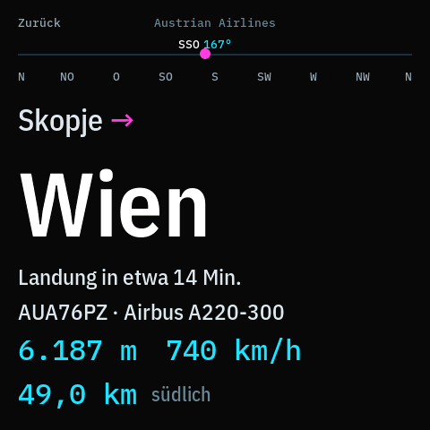
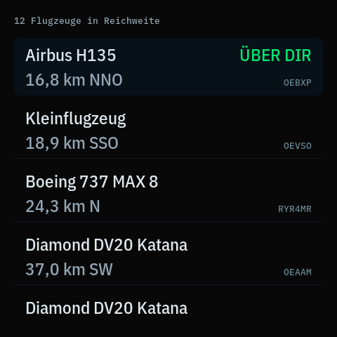
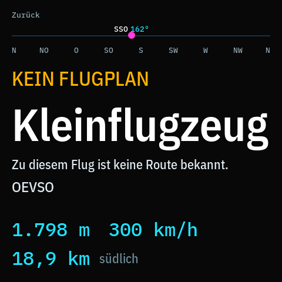

# Flight Radar

A 4-inch touch panel that answers one question:

> **That plane up there — where is it going, where did it come from, and what is it?**

It is built for a German-speaking user, so everything on the screen is in German.



Real traffic over Gloggnitz, Lower Austria, at 09:47 on 18 September 2026. This is what the
panel shows by itself, with nobody touching it: where the aircraft are, which way they point,
how many there are, north up, and the nearest one named along the bottom edge. Here the
nearest is a helicopter, 16.8 km to the north-north-east.

Tap an aircraft, and the panel answers in words:



An Austrian Airlines Airbus A220 from Skopje, 6,187 m up and 49 km to the south, due to land
in Vienna in about fourteen minutes. The same moment, the same sky.

## Why it exists

I built it for one person: my father-in-law. He is Austrian, in his eighties, and not
technical. When he hears a plane, he takes out his phone and opens Flightradar24. The panel
has to be faster and easier than that. If it is not, there is no reason for it to exist.

The whole design follows from two things he does:

- He **hears a plane and glances up.** The scope already shows where it is and how many are
  up there. He does not press anything.
- He **wants the answer in words.** He taps the aircraft.

That split is his own correction. The first version opened on the written answer and kept
the scope a swipe away, as the brief said. After living with it he asked for the other way
round, and he was right: the picture serves the glance, and the tap costs him nothing.

The same idea explains the rest:

- The destination is the headline in 100 px type, not a field in a table.
- It says "Airbus A220-300", not `BCS3`, and it names cities the way he would, not in the
  English the route service returns.
- The screen is never blank. An empty panel reads as *broken* to someone who did not build it.

He spends the year between Gloggnitz, Vienna and Pattaya. One tap moves the device: the
location, the time zone and the clock all follow. He never sets a clock, because the time
zone belongs to the place instead of being a setting beside it.

## The screens

There are two pages side by side, Radar and List. The answer in words is one layer under
either of them.

**Radar** is the default page, [pictured at the top](#flight-radar), north up. Magenta is the
nearest aircraft, cyan is every other one. A filled mark has a filed route; a hollow one has
not. The white ring shows which aircraft the caption is naming. Between polls the marks move
the way the aircraft do, instead of jumping once every twelve seconds.

**List** shows everything in range, nearest first, and it scrolls. Each row has two lines:
where it is going (or what it is, if there is no route), then how far and in which
direction. On the right, small: who it is. That is the flight number as printed on a ticket
(`OS 453` rather than the radio callsign `AUA453`) where one can be worked out, otherwise
the callsign or the registration. Most airline callsigns near Vienna carry letters
(`AUA25L`), and those carry no flight number at all. Where the pairs CI collects from
Vienna's airport board say which flight it is, the panel shows that number instead
(`OS 254`, D95).

The colours come from aviation, not from taste: magenta is the thing you are heading toward
(the route, the bearing, the nearest aircraft), green is normal, amber is a missing value.
No colour ever carries meaning on its own; there is always a shape or a word beside it. That
is FAA AC 25-11A and RTCA DO-257A, written by people who had already learned what happens
when a glance goes wrong.

**Moving around:**

- Swipe between Radar and List.
- Tap a mark on the radar to move the caption to that aircraft. Tap the caption to open the
  detail layer.
- Tap a row in the list to open the detail layer.
- On the detail layer, a back label sits top left. A tap anywhere on the screen does the same,
  because a man in his eighties should not have to aim for a button.
- After 30 seconds of an untouched, empty sky the deck returns to the radar by itself. The
  detail layer never closes on its own: if it is open, someone is reading it.

**Aircraft without a route are not a failure case.** In the capture above, the four nearest
aircraft had no flight plan: a helicopter, two light aircraft, and a Ryanair jet whose route
the route service itself marked as implausible. The light aircraft are exactly the ones he
*hears*, low and slow over the house. They keep the same layout: the type becomes the
headline, and an amber tag says what is missing.

| List | Detail, no route |
|---|---|
|  |  |

For a known light-aircraft type the sentence under the headline is more specific: only
flights with a flight number have a route.

**Everything else** lives in **Settings**, which opens with a long press anywhere on
the deck, so he cannot land there by accident:

- **Location** — where the device stands: Gloggnitz, Vienna, Pattaya, or any place found
  by name with the **location search**.
- **Radius** — how far to look (default 55 km).
- **Brightness** — plus a night dim window.
- **WiFi** — an on-screen network list and keyboard, with umlauts. No captive portal, no
  phone.
- **Software** — check for an update now, and install it now.

A small signal meter in the top right corner shows what the radio hears. Its steps were
measured on this hardware: one bar means "too weak for the aircraft poll to finish".

A 3-second press on the side key switches the device on, and the same press switches it off.

### How the pictures above are made

They are rendered on a computer, not photographed. `test/sim/sim_readme.c` runs the
**real screen code** and **real LVGL 9.6**, in the device's own render mode, into a
480 × 480 RGB565 framebuffer. The input is the **real adsb.lol capture and adsb.im route
answer** in `test/fixtures/`, parsed by the device's own parsers. Not drawn: the page dots
and the corner meters. They belong to the deck around the screens.

```bash
make -C test/sim readme    # re-renders docs/screens/ from the capture
```

On the unit itself, `tools/grab_screen.py` reads the live framebuffer back over USB. That is
how every layout bug in [`docs/DECISIONS.md`](docs/DECISIONS.md) was found.

## Hardware

**Waveshare ESP32-S3-Touch-LCD-4B**, the "Smart 86 Box":

- ESP32-S3-WROOM-1-N16R8: 16 MB flash, 8 MB octal PSRAM
- 480 × 480 ST7701 panel on an RGB565 bus, GT911 touch controller
- AXP2101 power management; power over USB-C
- a standard 86-type wall plate, 86.5 × 86.5 × 14 mm

An optional 3.7 V Li-ion cell on the PH2.0 header keeps it running for about four hours off
the cable. The driver is written and reads back correctly on the unit, but no cell has been
connected yet. Every code path works the same without one.

The full board profile — pins, I²C addresses, and what is **not** on the board despite the
reseller listings — is in [`docs/HARDWARE.md`](docs/HARDWARE.md). Beware: the
`ESP32-S3-Touch-LCD-4` without the "B" is a different board, and its pin table is wrong for
this one.

## Building it

Written in C with **ESP-IDF 5.4.4** (the patch level matters, see D81), the Waveshare BSP
and **LVGL 9.6**.

**Before the first build, generate a signing key.** Every image is signed (see
[Updating it remotely](#updating-it-remotely)). An unsigned build does not fail to compile:
it builds, flashes, and then aborts on boot.

```bash
. ~/esp/esp-idf/export.sh
idf.py secure-generate-signing-key --version 2 --scheme rsa3072 secure_boot_signing_key.pem
idf.py build
ls /dev/cu.usbmodem*          # the board re-enumerates; the node name is not fixed
idf.py -p /dev/cu.usbmodem101 flash monitor
```

WiFi credentials can be typed on the panel itself, or sent over serial into NVS. Either way
they never pass through this repository or a config file:

```bash
python3 tools/provision.py
```

**The timetable key, once per panel, over USB.** It lets the panel open the flight-number
pairs CI publishes (D95). Without it the panel shows callsigns (`AUA25L`), as it always has.
The panel must run v1.0.7 or later; the key is in the personal 1Password as
"esp-flight-monitor — timetable key (TIMETABLE_KEY)".

```bash
python3 tools/provision.py --timetable-key
```

The board has two USB-C sockets and only one of them reaches the console: the ESP32-S3's
own USB, which shows up as `USB JTAG/serial debug unit`. The other goes through a CH343
chip to the UART, where only the boot ROM speaks. The tool picks the right one by USB
vendor, and if it finds only the CH343 it stops and says to move the cable. With
the key in 1Password, it can go straight from there to the panel:

```bash
op item get --account my.1password.eu --vault Private \
  "esp-flight-monitor — timetable key (TIMETABLE_KEY)" --fields password --reveal \
  | python3 tools/provision.py --timetable-key --key-stdin
```

It prompts for the key without echoing it, stores it in the panel's NVS, then waits until
the panel has fetched and opened the timetable and says so ("done: the panel has the
pairs"). If it reports that the key does not open the file, the key on the panel and the
`TIMETABLE_KEY` secret differ.

## Standing it up

The board is a flush wall plate, which is the wrong shape for a table. So
[`hardware/desk_stand.scad`](hardware/desk_stand.scad) is a parametric wedge that holds it
at 20° off vertical. That is square to the sight line of someone seated about 70 cm away,
the same geometry the type sizes are set from. The footprint is 95 × 55 mm, one part, no
supports. A notch lets a right-angle USB-C plug leave sideways instead of pushing the stand
off the table.

**It has not been printed yet, and its dimensions come from the datasheet, not from
calipers on the real unit.** Render `part = "fittest"` first. It is only the slot and the
lip: four minutes of filament that tell you whether the depth is right before you commit to
an hour.

## How it gets verified

Everything that can be tested off the device is tested off the device. Neither needs a board
or a network. The host suite runs in under ten seconds from a clean tree; the simulators
need one `idf.py build` to fetch LVGL, then compile it once (about 20 s):

```bash
make -C test/host    # parsers, formatters, tables, settings, failover, OTA policy, gates
make -C test/sim     # Radar, List and detail layer: real LVGL, a scripted finger, ASan/UBSan
```

`make` prints the exact count; it is in the tens of thousands of checks. Most of them come
from exhaustive loops. One example: all 13,824 combinations of hour, dim-window start and
dim-window end, checking the updater's answer against the dimmer's. These are two
implementations of one midnight wrap, in two translation units that cannot share code. If
they ever disagreed, the device would dim at one hour and install at another, and only one
of the two is visible.

The simulators in `test/sim` render the real screens into a framebuffer, press them with a
scripted finger, and check the result from pixels. That is how the radar's touch handling
was verified without a board attached.

Three gates run with the host suite and fail the build:

- **`check_font_coverage.py`** — LVGL draws a missing glyph as *nothing at all*: no error,
  no placeholder, just text shorter than you wrote. This fails if any string needs a
  character the generated font lacks.
- **`check_strings.py`** — every user-facing word lives in `main/strings_de.h`. This fails
  if one leaks into a widget. `--list` prints the whole German vocabulary, grouped by
  screen, for reading aloud.
- **`check_console_keys.py`** — the serial debug console is documented in two places. This
  fails if either list drifts from the code.

## Updating it remotely

It spends half the year 9,000 km away, so it updates itself. It leaves the workshop not
knowing where from: press `u` on the serial console and paste the manifest URL.

```
https://github.com/MonsJovis/esp-flight-monitor/releases/latest/download/manifest.json
```

That GitHub release asset answers with a `302`; the device follows the redirect itself.
Behind it is the file each release publishes next to the image:

```json
{
  "version": "1.0.5",
  "url": "https://github.com/MonsJovis/esp-flight-monitor/releases/download/v1.0.5/esp-flight-monitor-1.0.5.bin",
  "size": 2428928
}
```

**Publishing a release is a tag.** `.github/workflows/release.yml` then:

1. runs the whole host suite,
2. builds with `PROJECT_VER` taken from the tag,
3. signs the image,
4. checks the finished binary against the tag (`tools/check_release.py`),
5. writes the manifest from the numbers it just verified, and uploads both.

```bash
git tag -a v1.0.6 -m v1.0.6 && git push origin v1.0.6
```

**Images are signed, and the device checks.** This is the Secure Boot V2 signature scheme
without hardware secure boot: no fuses are burned, and the bootloader can still be replaced
over USB. But a new image must be signed by the same key as the image already running, so
controlling the URL is not enough to control the device. The public half of the key is
`tools/ota_signing_key.pub.pem`. The private half is a GitHub Actions secret and nowhere
else. A key you generate yourself works fine on a panel you flash yourself; it just cannot
update the one already in Austria, which is the point.

**When it installs:**

- **By itself:** it checks about once a day and installs only inside the night dim window.
  That is a precaution, not a measurement. Small NVS writes were measured on this unit and do
  *not* tear the panel, but a 2.4 MB image write is a different workload, and nobody has yet
  watched the glass during one. At 3 a.m. it costs nothing to assume the worse case.
- **When asked:** the **Software** row in Settings checks now and offers to install right
  away. Someone standing in front of the panel does not want to wait for the night.

A fresh image boots on probation. It must stay on WiFi for two minutes before it confirms
itself; if it cannot, the bootloader puts the previous build back. Plain HTTP is refused:
whoever controls that URL controls the device.

## Data

- **Positions:** [adsb.lol](https://adsb.lol)
- **Routes:** [adsb.im](https://adsb.im)
- **Place names**, for the location search: [Open-Meteo's geocoding API](https://open-meteo.com/en/docs/geocoding-api)
- **Flight numbers** for callsigns like `AUA25L`: [AeroDataBox](https://aerodatabox.com),
  read by CI twice a day on its free plan, never by the panel itself (D95)

The first three are free, and the first two are run by volunteers, so this device is a
polite client:

- One position request every 12 seconds, never faster than 10. Rapid requests earn a `429`,
  then a multi-minute `503`.
- Route lookups are batched: one POST resolves every callsign on screen. Routes are cached in
  NVS, so a route survives a reboot and is never asked for twice. A route does not change
  mid-flight.
- The geocoder is called once when someone taps Search, and never otherwise.

Routes and place names go over **plain HTTP**, on purpose: a handshake nobody asked for buys
nothing. Positions have gone over HTTPS since adsb.lol stopped answering plain HTTP on
19 Oct 2026 (D92); the TLS buffers sit in PSRAM, so that costs no internal heap. Open-Meteo
won over Nominatim and Photon back when the whole data path was plain HTTP, because both
redirect to HTTPS. It also returns each place's time zone, which is what lets the clock
follow the location. Endpoints, measured rate limits and
the fallback order are in [`docs/DATA.md`](docs/DATA.md).

> Contains information from **adsb.lol**, which is made available under the
> [Open Database License (ODbL) v1.0](https://opendatacommons.org/licenses/odbl/1-0/).
> Any rights in individual contents of the database are licensed under the
> [Database Contents License](https://opendatacommons.org/licenses/dbcl/1-0/).
>
> Place data from **Open-Meteo**, derived from **[GeoNames](https://www.geonames.org/)**
> and made available under the
> [Creative Commons Attribution 4.0 licence](https://creativecommons.org/licenses/by/4.0/).
>
> Flight numbers from **[AeroDataBox](https://aerodatabox.com)**.

## Licence

This project's own code is [MIT](LICENSE).

It also reuses other people's code, fonts and data: the Waveshare BSP's display init path,
the route parser from sky_overhead, the rotated aircraft glyph from ThingPulse, IBM Plex, and
flight data from adsb.lol and Open-Meteo. Those come under their own terms, which travel
with them into any fork and into every firmware image built from this.
[THIRD-PARTY.md](THIRD-PARTY.md) lists what, from whom, and under which licence.

## Reading the repo

| File | What is in it |
|---|---|
| [`AGENTS.md`](AGENTS.md) | The operating manual and router: product intent, the dev loop, the serial console, settled decisions, conventions, and the three ways this repo has actually failed. |
| [`docs/DESIGN.md`](docs/DESIGN.md) | Colour meanings, type scale, size floors, every screen. Read before building one. |
| [`docs/PLAN.md`](docs/PLAN.md) | Milestones M0–M13 and what is actually done. |
| [`docs/DECISIONS.md`](docs/DECISIONS.md) | Every decision (D1–D91) and why, including the ones that turned out wrong. |
| [`docs/HARDWARE.md`](docs/HARDWARE.md) | The verified board profile. |
| [`docs/DATA.md`](docs/DATA.md) | The APIs, their measured rate limits, and the fallback order. |
| [`docs/GOTCHAS.md`](docs/GOTCHAS.md) | The things that cost a day each. Read before your first build. |
| [`docs/PLACES.md`](docs/PLACES.md) | Where the device stands, and what that means for the clock and the poll. |
| [`docs/RESEARCH.md`](docs/RESEARCH.md) | A survey of existing open-source flight radars, and what was worth taking. |
